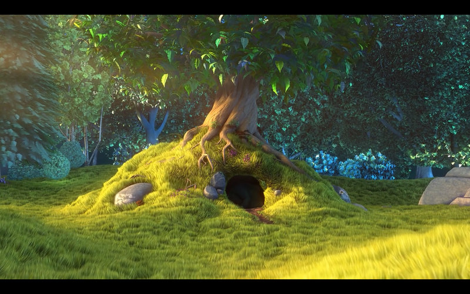
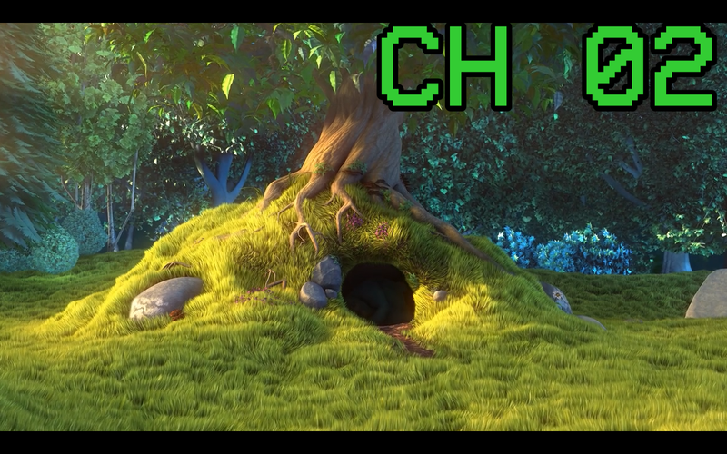
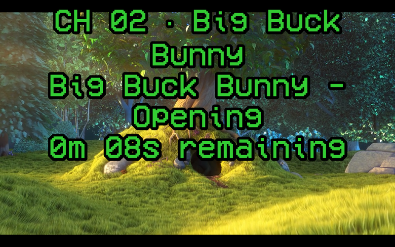

# Rabbit Ears

A dumb, kid-safe "cable box" built from a Dell Wyse 3040. Folders on a USB
drive become TV channels that are always "on the air." You can't pick a show —
only a channel. No internet content, no menus, no apps, nothing to get lost in.

Alpine Linux (diskless + `lbu`), one long-running mpv over DRM, and a 2.4 GHz
remote. `SCOPE.md` is the source of truth.

## What it looks like

**Every channel is always playing, mid-episode, wherever it "would be."** Tune
in and you land exactly on the clock-based schedule.



**Channel flash** — every tune flashes the channel number in blocky green for
~2.5 s.



**Info overlay** (`OK` on the remote) — channel, current episode, time remaining.



**NO SIGNAL** — pull the USB drive and it shows a test pattern instead of
crashing; re-insert the drive and it retunes automatically.


**Standby** (`Power`) — black screen, audio muted, schedule keeps ticking.
Only `Power` wakes it.


## How it works

| Piece | What it does |
|---|---|
| `channels/NN-slug/` on the USB drive | one folder per channel; `NN` is the channel number |
| `*.mp4` in a folder | episodes, played in filename order (or shuffled) |
| `mpv --vo=gpu --gpu-context=drm` | the one long-running player, VAAPI hwdec |
| `schedule.py` | position = `(now − EPOCH) mod loop_length`, pure clock math |
| [evdev remote](docs/remote.md) → `commands.py` → `App.handle` | the only path from a button to an action; full button map in `docs/remote.md` |
| `control.py` | local root-only control socket for `rabbitears.ctl` |

## Quick start

### 1. Build the box

The full procedure (diskless install, `lbu`, first-boot checklist) is in
[`docs/alpine-install.md`](docs/alpine-install.md). In short:

```sh
# desktop: build + boot the validation VM (dev loop)
uv run task vm-build
uv run task vm-run
uv run task deploy-vm
```

A real Wyse 3040 follows the same `alpine/deploy.sh --host H --commit --reboot`
path after a base Alpine install.

### 2. Load media

Media must be MP4, H.264 ≤ L4.1, ≤ 720p, AAC (SCOPE §5). Transcode on the
desktop, never on the box:

```sh
uv run task transcode SRC_DIR DEST_DIR   # anything → compliant MP4
uv run task media-check DEST_DIR         # confirm compliance
```

Then copy folders onto a USB drive labeled `RABBITEARS` (exFAT):

```
RABBITEARS/
├── channels/
│   ├── 02-big-buck-bunny/
│   │   └── Big Buck Bunny - Opening.mp4
│   └── 03-magic-school-bus/
│       └── S01E03 - Gets Eaten.mp4
└── .rabbitears/          # generated: index.json + state.json
```

The box re-indexes missing durations at boot; filenames become on-screen titles.

## Repository

```
rabbitears/
├── SCOPE.md            # scope, decisions, milestones (source of truth)
├── docs/               # install, remote, hardware, screenshots
├── src/rabbitears/     # the app (stdlib-only, runs on Alpine)
├── system/             # OpenRC, mpv.conf, mdev, fonts
├── alpine/             # idempotent setup/deploy/verify
├── vm/                 # KVM validation VM + e2e pipeline
├── tools/              # transcode, index, test pattern
└── tests/              # stdlib unittest
```

See [`SCOPE.md`](SCOPE.md) for goals, non-goals, and the milestone plan.
