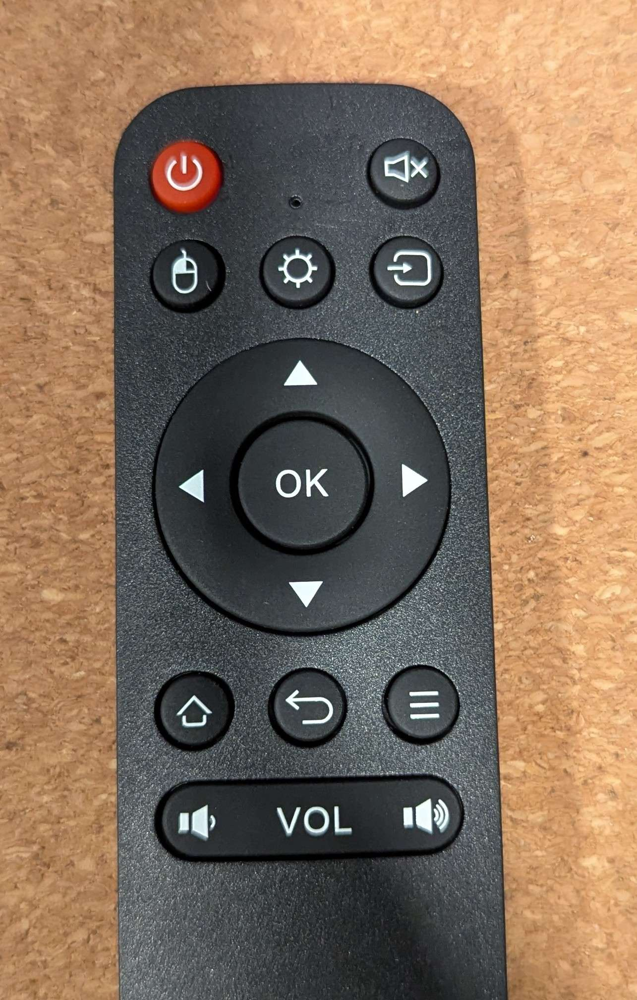

# Remote — Adomax 2.4GHz

> The verified reference for the Rabbit Ears remote + dongle: the full evdev
> button map and the Rabbit Ears role mapping (which buttons do what in the app).

## 1. Hardware

| Property | Value |
|---|---|
| Vendor / Product | Adomax Technology Co., Ltd — "2.4G Composite Devic" |
| USB ID | **`0627:697d`** |
| Type | 2.4GHz wireless nano receiver, factory pre-paired with the remote |
| USB spec | USB 1.1, 50 mA, bus-powered, remote-wakeup capable |
| Kernel driver | `hid-generic` (no vendor driver) |
| Input interfaces | 3: keyboard, consumer control, system control — plus a 5-button mouse (gyro) |

**Form factor:** 13 physical controls — red power, mute, mouse-mode,
sun/brightness, screen-arrow, D-pad + OK, home, back, menu, and a VOL rocker.
No QWERTY keyboard.

## 2. Complete button map (verified live)

| Button | evdev code | Keysym | Interface |
|---|---|---|---|
| 🔴 Power (top-left) | `KEY_POWER` (116) | `XF86PowerOff` | System Control |
| Mute | `KEY_MUTE` (113) | `XF86AudioMute` | Consumer Control |
| Mouse (gyro) | *none — local gyro toggle* | — | — |
| Sun (brightness) | `KEY_BACKSPACE` (14) | `BackSpace` | Keyboard |
| Screen-arrow (input switch) | `KEY_DELETE` (111) | `Delete` | Keyboard |
| OK (centre of D-pad) | `KEY_ENTER` (28) | `Return` | Keyboard |
| D-pad ↑ | `KEY_UP` (103) | `Up` | Keyboard |
| D-pad ↓ | `KEY_DOWN` (108) | `Down` | Keyboard |
| D-pad ← | `KEY_LEFT` (105) | `Left` | Keyboard |
| D-pad → | `KEY_RIGHT` (106) | `Right` | Keyboard |
| Home | `KEY_HOMEPAGE` (172) | `XF86HomePage` | Consumer Control |
| Back | `KEY_BACK` (158) | `XF86Back` | Consumer Control |
| Menu | `KEY_COMPOSE` (127) | `Menu` | Keyboard |
| VOL − | `KEY_VOLUMEDOWN` (114) | `XF86AudioLowerVolume` | Consumer Control |
| VOL + | `KEY_VOLUMEUP` (115) | `XF86AudioRaiseVolume` | Consumer Control |

## 3. Verified behaviours

- **Clean press/release pairs, no key repeats.** The app owns repeat — channel
  up/down only: first repeat after `repeat_delay`, then every `repeat_interval`.
- **No play/pause key** — fits "folders = channels": you only zap.
- **Gyro air-mouse is weak/unreliable** — the cursor barely moves. The
  mouse-icon button only toggles the remote's local gyro mode and sends no key
  event. Design for D-pad + OK only; ignore the mouse interface.
- **USB remote wakeup** is supported (can wake the box from sleep).
- **Plug and play** — no vendor driver, no pairing, no config. The app scans
  every `/dev/input/event*` whose vendor is `0x0627` and opens all matching
  interfaces (the buttons are split across them).

## 4. Rabbit Ears role mapping (SCOPE §4.4, §4.9)

| Button | Action |
|---|---|
| D-pad ↑ / ↓ | Channel up / down (hold to auto-repeat) |
| D-pad ← / → | Sleep chooser: previous / next option |
| OK | Toggle info overlay; confirm the highlighted sleep option |
| Back | Dismiss overlay; close the chooser; cancel the sleep countdown |
| VOL + / − | Volume up / down (clamped; never unmutes — mute is independent) |
| Mute | Toggle mute |
| Power | Standby ↔ on |
| Sun | Open/advance the sleep-timer chooser |

**Reserved — recognised but ignored:** Home, Menu, Screen-arrow, Mouse (gyro).
They are logged and skipped (SCOPE §4.4 "All others: ignored").
